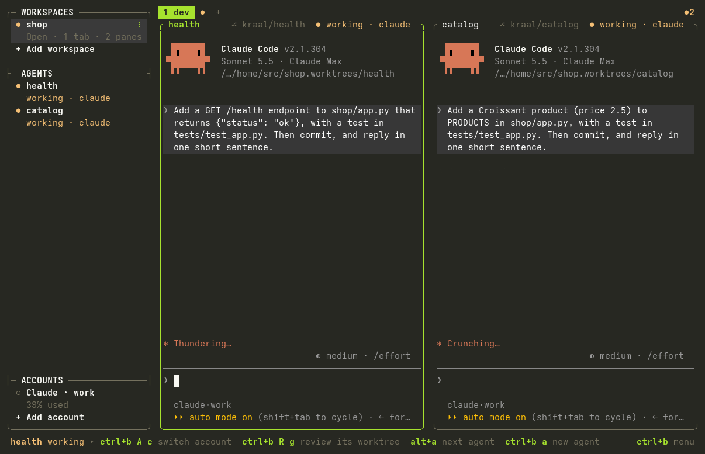

<h1 align="center">kraal</h1>

<p align="center">
  <b>Your coding agents and your servers, in one terminal.</b>
</p>

<p align="center">
  <a href="#install">Install</a> ·
  <a href="#quick-start">Quick start</a> ·
  <a href="docs/README.md">Docs</a> ·
  <a href="https://github.com/vodhash/kraal/releases">Releases</a>
</p>

<p align="center">
  <a href="https://github.com/vodhash/kraal/actions/workflows/ci.yml"></a>
  <a href="https://github.com/vodhash/kraal/releases/latest"></a>
  <a href="https://crates.io/crates/kraal"></a>
  <a href="LICENSE"></a>
</p>

<p align="center">
  
</p>

kraal is a terminal multiplexer for developers who run coding agents, and for the people who look
after servers: often the same person. Each pane knows the agent working there and the account it
uses, the server it is on, and whether that server is production.

**For your coding agents**

- **See which agent needs you.** Claude Code, Codex, OpenCode, Gemini and 26 others are marked
  working, blocked or done, in the sidebar and on their pane, with a desktop notification. Those
  running in kraal on your servers are listed too. `alt+a` jumps to the next one that needs you.
- **Several agents on one repository.** Start an agent in its own worktree and branch, then
  review, commit, open a pull request or merge without leaving kraal.
- **Claude Code agent teams in kraal panes.** `kraal agent claude --teams`: each teammate opens
  in its own pane next to the lead, followed like any other agent.
  [Agent teams](docs/agents.md#claude-code-agent-teams)
- **Named Claude and Codex accounts.** See each account's 5-hour and weekly usage, choose
  accounts per project, and change an agent pane's account with an Undo action. Claude can
  continue a verified conversation; changing Codex accounts starts a new one.
  [Accounts and limits](docs/agents.md#accounts)

**For your servers**

- **Your servers, one key away.** Add a server explicitly, or review a discovered connection
  before saving it. Open one, or a whole group in a grid; type in all of them at once; copy files
  between any two; keep tunnels open. kraal uses your own `ssh` and installs nothing on servers.
- **Production looks like production.** A pane on a production server, cluster, Terraform
  workspace or AWS profile gets a red frame. kraal asks before broadcast typing or a multi-line
  paste lands there. When an agent acts on production through kraal (`kraal exec`, `cp`, `rm`,
  `ssh`, `send`…), you see the exact plan and approve it first, and it is logged.
  [Production](docs/production.md)
- **Runbooks that stop at the first failure.** Procedures kept as files run server by server
  after showing their plan, and log everything. Your Markdown docs run block by block.

**Everywhere**

- **Close the terminal, keep working.** Sessions keep running when the window closes or the
  connection drops. Workspaces keep their layout automatically, including after Close, and
  Delete offers recovery. After a reboot, kraal restores saved layouts and available scrollback;
  [resume rules](docs/workspaces.md#what-resumes) determine which programs restart.
- **Tools where you are.** lazygit, k9s, htop or the logs open on the focused pane's server or in
  its directory. `ctrl+b o` labels every link, path, commit or pod on screen, to copy or open it.
- **One binary, any modern terminal.** Linux and macOS. The kitty keyboard protocol (Shift+Enter
  reaches Claude Code), images in panes (kitty graphics and sixel), shell integration, the mouse.

<p align="center">
  
</p>

## Install

```sh
curl -fsSL https://raw.githubusercontent.com/vodhash/kraal/main/install.sh | sh
```

Or, with Rust 1.88 or later:

```sh
cargo install kraal
```

The script takes the [prebuilt archive](https://github.com/vodhash/kraal/releases) for your
machine (Linux and macOS, x86_64 and arm64), checks its checksum and installs into
`~/.local/bin`. To update later, `kraal update` for the script's install, `cargo install kraal`
again for Cargo's. [More ways](docs/install.md)

## Quick start

```sh
kraal
```

This starts a session, or attaches to the one already running. Press `ctrl+b` and let go: a menu
shows what each next key does. `ctrl+b w` opens Workspaces, `ctrl+b s` opens Servers,
`ctrl+b a` starts an installed agent, with named accounts for Claude and Codex. Use `ctrl+b A l` for Accounts
and **+ Add account** if none is listed. Each management list has **+ Add**; search only filters.
The bar at the bottom shows what can be done in the focused pane, and its keys.

To leave, `ctrl+b d` detaches: programs keep running, and `kraal` brings you back where you were.
`ctrl+b q` quits: programs stop, and the layout is saved for the next `kraal`.

kraal reads each agent's state from its screen. To get exact states from the agent itself, install
its hooks once (here Claude Code; `kraal integration status` lists the others):

```sh
kraal integration install claude
```

## Why not tmux, Ansible or plain ssh?

Keep them: kraal runs your own `ssh`, and its panes run whatever you ran in tmux. What it adds is
the layer between them:

| | tmux | Ansible, pdsh | kraal |
|---|---|---|---|
| Layouts and scrollback restored after a reboot | with plugins | — | built in |
| Which agent is working, blocked or done, and on which account | — | — | ✔ |
| One command on a whole group of servers | — | ✔ | ✔ `kraal exec @group` |
| A live grid of servers, typing in all of them at once | by hand | — | ✔ |
| Production framed in red, confirmations before it is reached | — | — | ✔ |
| An agent's production actions through kraal wait for your approval | — | — | ✔ |
| Runbooks that show their plan and stop at the first failure | — | playbooks | ✔ |

## Local-first

No account and no telemetry. kraal reaches the network only for what you ask: your `ssh`
connections, `git` and `gh` for pull requests, and `kraal update`. Nothing is installed on your
servers unless you ask for it (`kraal remote-install`). Apache-2.0.

## Keys you can guess


After `ctrl+b`, a theme's letter runs its main action and the capital opens its menu: `s`
connects to a server, `S` shows everything about servers. The same letters mean the same thing in
every menu (`n` new, `x` close, `e` rename). Shortcuts work on any keyboard layout, and every command
and every menu can move to the keys you want.
[Keys](docs/keys.md)

## Workspaces kept automatically

Open Workspaces (`ctrl+b w`), choose **+ Add workspace**, give it a name and select **Add**.
Arrange tabs and panes as you work. **Close** keeps the layout as **Closed**; **Open** brings it
back. **Rename** changes its name in kraal, never a file. **Delete** moves it to **Deleted
workspaces**, where **Restore** brings it back closed, even after a restart.

KDL files are reusable startup layouts. Save the following as `shop.kdl`, then use
`kraal import ./shop.kdl` to preview and add it. Shells can start; imported commands and agents
wait for Enter. Export a copy with `kraal export ./shop-copy.kdl --workspace shop`.
Neither operation is needed to keep your workspace, and exports contain no conversations.

```kdl
layout {
    cwd "~/src/shop"
    tab name="release" {
        pane split_direction="vertical" {
            pane command="ssh" { args "deploy@web-prod-1"; }
            pane split_direction="horizontal" {
                pane agent="claude"              // Claude Code, on the account the rules pick
                pane preview="CHANGELOG.md"      // a live Markdown preview
            }
        }
    }
}
```

[Sessions and workspaces](docs/workspaces.md) · [this file](examples/workspaces/release.kdl),
among the [examples](examples/README.md) to copy

## Made to be scripted

Every pane knows its session, so scripts and agents drive kraal from inside it:

| Command | |
|---|---|
| `kraal run --right --name tests -- cargo test` | a new pane; prints its id |
| `kraal wait -p api --until blocked,done` | until the agent in "api" needs you |
| `kraal exec @prod -- uptime` | on every server of a group, in parallel |
| `kraal events agent.blocked pane.failed` | what happens, as JSON lines |

`[hooks]` runs a command on any event: ping your phone when an agent is blocked, log every SSH
connection to production. [Scripting, events and hooks](docs/scripting.md)

## Documentation

[Install](docs/install.md) ·
[Keys](docs/keys.md) ·
[Sessions and workspaces](docs/workspaces.md) ·
[Servers](docs/servers.md) ·
[Coding agents](docs/agents.md) ·
[Tools, contexts and hints](docs/tools.md) ·
[Production](docs/production.md) ·
[Runbooks](docs/runbooks.md) ·
[Shell integration and images](docs/terminal.md) ·
[Scripting, events and hooks](docs/scripting.md) ·
[Configuration](docs/configuration.md) ·
[Compatibility](docs/compatibility.md)

[Examples](examples/README.md): workspaces, configurations, an inventory, account rules, runbooks
and scripts to copy, each one tested with the program.

## The name

A kraal is an enclosure for cattle, in southern Africa. Servers are cattle, not pets, and now
agents are too.

## Status

kraal is young. Linux is used every day; macOS passes the whole test suite on every release but
nobody uses it daily yet; Windows is not supported. Known gaps:

- Images in panes and previews need a terminal that draws kitty graphics with Unicode
  placeholders (Ghostty, kitty) or sixel (foot, WezTerm, Konsole, Windows Terminal…); elsewhere
  their cells stay blank, and previews use half blocks. Over sixel, an image that output scrolls
  shows again once it stays put, and never on the window's last row.
- Agent states come from hooks for Claude Code and eight other agents, and for what Gemini CLI's,
  Codex's, Cursor's and Augment's hooks tell; otherwise they are read from the screen and can lag.
- The production guard is a safety net based on names, not a permission system: an agent that
  runs `ssh` or a cloud CLI itself does not go through kraal.

Bug reports and ideas are welcome in the [issues](https://github.com/vodhash/kraal/issues).

## Development

The unit and end-to-end tests, which also check these pages against the program (every command
line, key, setting and example they quote):

```sh
cargo test
```

On Linux, the idle-worker tests count thread context switches to detect polling. The measured
workers block signals so unrelated process activity cannot look like polling. These tests send
SIGCHLD during the measurement and check that real work still wakes the workers afterwards.

## License

Copyright 2026 vodhash and the kraal contributors.

Licensed under the [Apache License, Version 2.0](LICENSE).

Unless you explicitly state otherwise, any contribution intentionally submitted for inclusion in
kraal by you, as defined in the Apache-2.0 license, shall be licensed as above, without any
additional terms or conditions.
